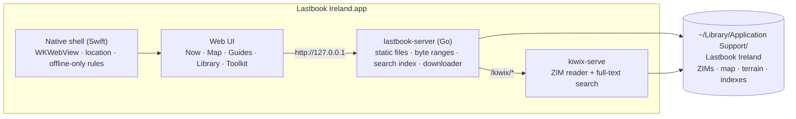

<div align="center">


# Lastbook Ireland

**An offline emergency and self-reliance companion for the island of Ireland.**<br>
Maps, medical references, survival manuals, Wikipedia and a library for rebuilding — on your Mac, with no internet at all.

[Download](https://github.com/fpl0/lastbook-ireland/releases/latest) · [Download the offline data](#2-download-the-offline-data) · [How it works](#how-it-works) · [What's inside](#whats-inside)

</div>

---

When the power is out, the phone network is down and the internet is gone, Lastbook still works. It is a native macOS app that carries:

- **A detailed map of the whole island** — every road, track, building and townland, with hill shading, 10 m contours, Irish Grid / ITM references and 40,000 points of help (A&E, defibrillators, pharmacies, Garda/PSNI, water, shelter).
- **25 offline libraries — 1.9 million articles** — Wikipedia, every medical article on Wikipedia, NHS Medicines A–Z, army survival and military medicine manuals, *Where There Is No Doctor*, iFixit repair guides, and open textbooks for trades, engineering and science.
- **Field guides** written for Ireland (CPR, bleeding, hypothermia, storms, boil-water notices, flooding, foraging…), each linked straight to the right page of the right manual.
- **Official guidance** from gov.ie *Be Emergency Ready*, nidirect, HSE, Met Éireann and the EPA, saved for offline use.

It is built to be **100% offline**: the app's web view refuses every network request that isn't to its own local engine.

## Contents

- [Screens](#screens)
- [Install](#install)
- [What's inside](#whats-inside)
- [How it works](#how-it-works)
- [Verifying it's really offline](#verifying-its-really-offline)
- [Refreshing the data](#refreshing-the-data)
- [Project layout](#project-layout)
- [Known limitations](#known-limitations)
- [Credits and licences](#credits-and-licences)

## Screens

| | |
|---|---|
| **Now** | 112/999 at a glance. *Where am I?* gives the Irish Grid reference, ITM and lat/lon to read to the emergency services, plus the nearest town. Nearest help shows the closest A&E, defibrillator, pharmacy, Garda station, water, shelter and more — distance and compass bearing. Daylight times for your position. |
| **Map** | Full OpenStreetMap vector map (light/dark/grey/paper styles, English or Irish labels), hillshade, contours, optional 3D terrain. Search 99,000 places — towns, townlands, peaks, lakes — or type a grid reference. Tap anywhere for grid refs, elevation and the nearest help. Measure distance, ascent and Naismith walking time. |
| **Guides** | 29 field guides. Each starts with what to do, then links live into the encyclopedia articles and the exact pages of the survival and medical manuals. |
| **Library** | All 25 libraries in four sections — *Emergency & medicine*, *Survival & preparedness*, *Rebuilding: skills, energy & science*, *General knowledge*. Full-text search across everything, page-level search inside 160 PDF manuals, native shelves for the document collections and CD3WD, bookmarks, and a reader that restyles articles to match the app in light and dark mode. |
| **Data** | Download the offline data from inside the app: pick *Essentials* (~12 GB), *Everything* (~31 GB) or individual libraries, see free disk space, and watch each item arrive. Pause any time; interrupted downloads resume, even after quitting. |
| **Toolkit** | Emergency kit checklist and household plan (saved on your Mac), coordinate converter, distance & bearing, bleach dosing for water, household food & water calculator, Morse code and an SOS screen flasher. |

Press <kbd>⌘K</kbd> anywhere to search everything at once — places, guides, manuals and encyclopedias.

## Install

Lastbook has two parts: the **app** (small) and the **offline data** (large, downloaded once).

### Requirements

- macOS 13 or later (Apple silicon or Intel)
- Disk space for the data you choose: ~12 GB for the essentials, ~31 GB for everything
- An internet connection **once**, to download the data

### 1. Get the app

**Download** `Lastbook-Ireland-macOS.zip` from the [latest release](https://github.com/fpl0/lastbook-ireland/releases/latest), unzip it and move **Lastbook Ireland.app** to Applications.

The app is not notarised by Apple, so the first time you open it: right-click → **Open** → **Open**. (Or run `xattr -dr com.apple.quarantine "/Applications/Lastbook Ireland.app"`.)

### 2. Download the offline data

Do this **now, while you have internet** — it is what makes Lastbook useful in an emergency.

Open Lastbook and click **Data** at the bottom of the sidebar (or *Download offline data* on any screen that needs it). Choose:

- **Essentials (~12 GB)** — the map and terrain, every medical and survival library, the rebuilding libraries, the most-read Wikipedia articles and the official guidance; or
- **Everything (~31 GB)** — adds iFixit, Wikibooks, Wikivoyage and the full LibreTexts science shelf; or
- tick individual items.

Then press **Download**. Everything goes into `~/Library/Application Support/Lastbook Ireland`:

- libraries come from [download.kiwix.org](https://download.kiwix.org/zim/) and are each checked against their published SHA-256;
- the map is cut to Ireland straight out of the latest [Protomaps](https://protomaps.com) planet build, and the terrain out of [Mapterhorn](https://mapterhorn.com) — only the tiles covering the island are fetched;
- the official guidance is saved from gov.ie, nidirect, HSE, Met Éireann and the EPA;
- the search index for the manuals is built on your Mac.

Smaller items come first, so the essentials are usable early. You can keep using the app while it downloads, pause at any time, and if the download is interrupted (or you quit) it picks up where it stopped. Until the data is installed the guides, toolkit and emergency numbers already work, and the Map and Library offer the download.

> **Tip:** the data folder is self-contained. Copy `~/Library/Application Support/Lastbook Ireland` to an external drive and you can set up another Mac with no internet at all.

### Build from source

Needs Xcode Command Line Tools (`xcode-select --install`) and [Go](https://go.dev).

```bash
git clone https://github.com/fpl0/lastbook-ireland.git
cd lastbook-ireland
./mac/build.sh          # builds and installs /Applications/Lastbook Ireland.app
```

`UNIVERSAL=1 ./mac/build.sh` makes a release build for both Apple silicon and Intel. Developers can also fetch the data from the command line with `./tools/setup.sh` (needs Python 3 and [`pmtiles`](https://github.com/protomaps/go-pmtiles)); it produces the same data folder as the in-app download.

## What's inside

### Libraries

| Section | Library | Size | What it is |
|---|---|---:|---|
| Emergency & medicine | **WikiMed Medical Encyclopedia** | 1.8 GB | Every medical article on Wikipedia, with images |
| | **NHS Medicines A–Z** | 15 MB | Uses, doses, side effects and interactions for 1,300+ medicines |
| | **Austere Medicine Library** | 81 MB | *Where There Is No Doctor* and *Dentist*, *Emergency War Surgery*, wound closure, wilderness medicine, midwifery |
| | **Military Medicine** | 62 MB | US military medical manuals: first aid, combat casualty care, Special Forces medical handbook |
| | **Medicine Textbooks** (LibreTexts) | 1.1 GB | Open university textbooks: anatomy, physiology, nursing, pharmacology |
| Survival & preparedness | **Post-Disaster Library** | 624 MB | 87 manuals: US Army FM 21-76 Survival, nuclear survival, shelters, foraging, preserving, trapping |
| | **Water Treatment**, **Food & Preserving**, **Knots & Rope** | 144 MB | Purifying water, canning and drying, knots and lashings |
| | **Gardenology** | 112 MB | Encyclopedia of plants and gardening |
| Rebuilding | **CD3WD** | 560 MB | 985 development publications (FAO, WHO, ITDG, Peace Corps…): farming, water, building, energy, health, small industry |
| | **Appropedia** | 560 MB | Appropriate technology and low-tech solutions |
| | **Energypedia** | 768 MB | Off-grid energy: solar, micro-hydro, biogas, cookstoves |
| | **LibreTexts**: Trades & Workforce, Engineering, Chemistry, Physics, Biology, Mathematics, Social Science | 8.5 GB | Open textbooks — from welding and wiring to governance and economics |
| | **iFixit** | 3.3 GB | Step-by-step repair guides for tools, radios, appliances, cars |
| General knowledge | **Wikipedia** (top articles) | 6.5 GB | The most-read English Wikipedia articles, with images |
| | **Wikibooks** | 4.4 GB | Open textbooks and manuals |
| | **Wikivoyage** | 1.1 GB | Every county, town and region |
| | **Internet Encyclopedia of Philosophy** | 128 MB | Peer-reviewed philosophy reference |

Libraries are [Kiwix](https://kiwix.org) ZIM archives from `download.kiwix.org`.

### Map

- **Basemap:** [Protomaps](https://protomaps.com) build of OpenStreetMap, zoom 0–15, covering 12°W–4.3°W, 50.8°N–56°N (the island plus the Atlantic edge, North Channel, Isle of Man and Galloway) — 643 MB.
- **Terrain:** [Mapterhorn](https://mapterhorn.com) elevation (Copernicus GLO-30 and national DEMs), ~11 m resolution, for hillshade, contours, 3D and spot heights — 287 MB.
- **Places and help points:** 99,000 named places (including townlands and Irish names) and 40,000 resources from OpenStreetMap via Overpass.

### Official guidance

77 pages and documents saved from gov.ie (Office of Emergency Planning — *Be Emergency Ready* 2026 booklet, checklist and numbers), nidirect, UK *Be Ready*, HSE condition pages, Met Éireann, Water Safety Ireland, the EPA (including the *National Plan for Nuclear and Radiological Emergency Exposures*) and Sweden's *In case of crisis or war*.

## How it works



- **Native shell** (`mac/main.swift`) — starts the engine on a random local port and shows the UI in a WKWebView. A WebKit content rule list blocks every request that isn't to `127.0.0.1`, so nothing can reach the internet, even by accident. Location comes from CoreLocation through a small bridge (Macs locate via Wi-Fi, which may not work offline — tapping your position on the map always does).
- **Engine** (`server/`, Go) — serves the UI and the data folder with HTTP range support (the map is one PMTiles file read in ranges), runs and proxies `kiwix-serve`, and keeps an in-memory page-level index of every manual and guidance document for full-text search. It is also the downloader behind the **Data** screen: resumable, checksum-verified library downloads; a PMTiles extractor that reads only Ireland's tiles from a remote planet archive with HTTP range requests; the guidance snapshot; and the index builder (PDF text via a small PDFKit helper, `pdftext`).
- **Web UI** (`web/`) — plain JavaScript, no build step. The map is a [MapLibre GL](https://maplibre.org) module with PMTiles, Protomaps basemap styles and client-side contours.
- **Reader** — library pages open inside the app and are restyled to match it (serif headings, the app's colours, Wikipedia's own night mode underneath in dark mode). Archived websites keep working links through their replay script, and their online-only search boxes are redirected to the offline search.

## Verifying it's really offline

Two scripts check the installed data against the running engine:

```bash
python3 -I tools/audit_offline.py http://127.0.0.1:<port> 30
python3 -I tools/crawl_check.py  http://127.0.0.1:<port> cd3wdproject.org_en_all_2026-11 600 www.cd3wdproject.org
```

`audit_offline.py` opens 30 random pages from every library and fetches every image, stylesheet, script, font and video they reference, then opens every manual PDF. `crawl_check.py` follows one library's links breadth-first and checks every target exists in the archive. The engine's port is in `~/Library/Application Support/Lastbook Ireland/server.log`.

Latest results: **701 of 701** random pages and **204 of 204** manuals open offline; nothing content-bearing depends on the internet. A handful of decorative assets were never captured by the original archives (about 1% of Wikipedia images, some theme backgrounds and web fonts).

## Refreshing the data

Open **Data** to add libraries you skipped or retry anything that failed. To move to newer library editions, update the file names in `server/setup.go` (see [download.kiwix.org/zim](https://download.kiwix.org/zim/)), rebuild, and delete the old `.zim` from the data folder. The map always comes from the latest Protomaps build.

Command-line equivalents, for developers:

| Script | What it does |
|---|---|
| `tools/setup.sh` | Everything below, in order |
| `tools/fetch_library.sh` | Downloads and checksum-verifies the Kiwix libraries |
| `tools/fetch_map.sh` | Extracts the Ireland map and terrain |
| `tools/build_data.py` | Rebuilds the bundled gazetteer and help-point layers (`web/appdata/`) from Overpass results |
| `tools/fetch_guidance.py` | Snapshots the official guidance |
| `tools/build_docs.py` | Page-level text index of every manual (PDFKit) |
| `tools/build_cd3wd.py` | CD3WD catalogue with real titles and subjects |
| `tools/audit_offline.py`, `tools/crawl_check.py` | Offline verification |

## Project layout

```
mac/        native macOS shell (Swift) and build script
server/     local engine and downloader (Go)
web/        the app UI — index.html, app.js, library.js, guides, styles
web/map/    offline map module (MapLibre, PMTiles, basemaps, contours, fonts, sprites)
web/appdata/ places gazetteer and help points (OpenStreetMap), shipped inside the app
tools/      data download, indexing and verification scripts
raw/        Overpass queries for places and help points
```

## Known limitations

- **Location offline:** Macs find their position via nearby Wi-Fi, which normally needs an internet lookup. Offline, tap your position on the map and choose *I am here*.
- **Help points come from OpenStreetMap** and can be out of date or incomplete — confirm opening hours and A&E status by phone when you can.
- **LibreTexts** textbooks have no full-text index, so search finds them by page title only.
- **Archives are snapshots:** a few images were never captured upstream, and official guidance reflects the date it was saved.
- **Not medical advice.** Lastbook is a reference. In an emergency, call **112** or **999**.

## Credits and licences

Lastbook bundles or downloads work from many projects; each keeps its own licence.

- **Map data** © [OpenStreetMap](https://www.openstreetmap.org/copyright) contributors, ODbL. Basemap tiles and styles: [Protomaps](https://protomaps.com). Terrain: [Mapterhorn](https://mapterhorn.com) (Copernicus GLO-30 and national elevation models). Fonts: Noto Sans (SIL OFL).
- **Map software:** [MapLibre GL JS](https://maplibre.org) (BSD-3), [PMTiles](https://github.com/protomaps/PMTiles) (BSD-3), [@protomaps/basemaps](https://github.com/protomaps/basemaps) (BSD-3), [maplibre-contour](https://github.com/onthegomap/maplibre-contour) (BSD-3).
- **Libraries** are distributed by [Kiwix](https://kiwix.org) under their sources' terms — Wikipedia, Wikibooks and Wikivoyage (CC BY-SA), NHS content (Open Government Licence), US government manuals (public domain), iFixit (CC BY-NC-SA), LibreTexts (per-book open licences), and the individual publishers of the CD3WD, Appropedia, Energypedia, Gardenology and IEP collections. See each library's own pages for details.
- **Library engine:** [kiwix-serve](https://github.com/kiwix/kiwix-tools) (GPL-3.0; source at that link), downloaded at setup time and bundled unmodified in the app.
- **Official guidance** © its publishers (gov.ie, nidirect, HSE, Met Éireann, EPA, UK Government, MCF Sweden), saved for personal offline use; each page links to its original.

Built with [Claude Code](https://claude.com/claude-code).
